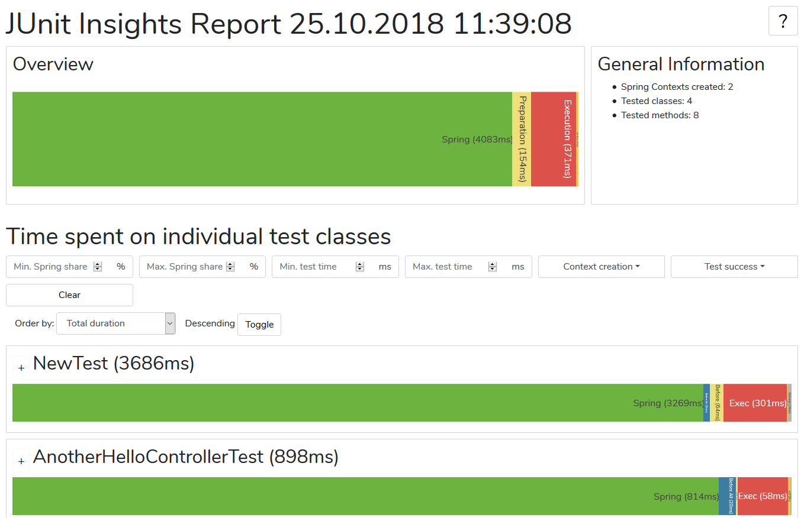
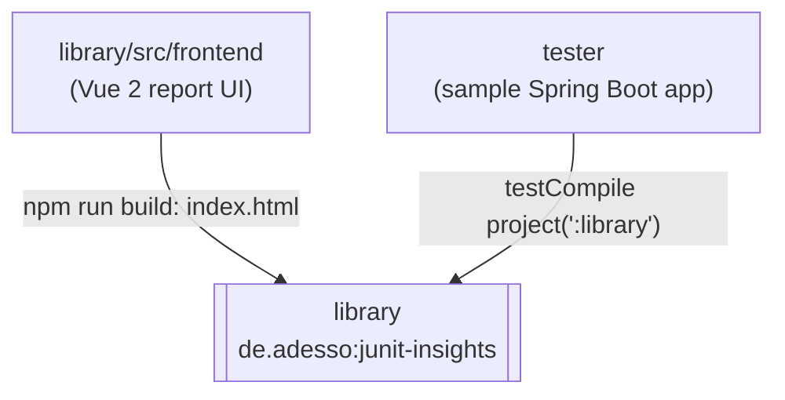
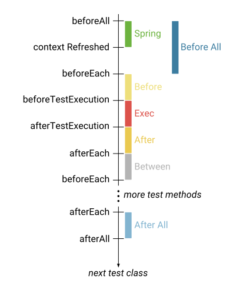

<div align="center">

# 📚 junit-insights

**Shows where slow JUnit 5 suites spend time: test phases and Spring context startups**

Glovo's fork of [adessoSE/junit-insights](https://github.com/adessoSE/junit-insights): a Kotlin
library (`de.adesso:junit-insights`) that you put on a project's test classpath. While tests run,
it records JUnit Jupiter callbacks and Spring context events, then writes one HTML report. It is
not a test runner or a service, and it never runs in production. The fork adds two commits on top
of upstream: Kotlin is no longer embedded in the jar, and the root Gradle wrapper is 6.8.3.

[](build.gradle)
[](build.gradle)
[](gradle/wrapper/gradle-wrapper.properties)
[](library/build.gradle)
[](build.gradle)
[](library/src/frontend/package.json)
<br/>
[](library/build.gradle)
[](LICENSE)
<br/>
[](#testing)
[](https://github.com/adessoSE/junit-insights)

</div>

---

## Table of contents

- [Overview](#overview)
- [Modules](#modules)
- [Adding JUnit Insights to a project](#adding-junit-insights-to-a-project)
- [Build & local development](#build--local-development)
- [Testing](#testing)
- [Repository layout](#repository-layout)
- [Contributing & conventions](#contributing--conventions)
- [Glossary](#glossary)
- [Ownership & support](#ownership--support)

---

## Overview

When you build integration tests with Spring (e.g. with `@SpringBootTest`), sometimes a **Spring
application context** has to be started and sometimes it doesn't. To whoever runs the suite, some
tests look slow even though the test itself runs quickly. JUnit Insights makes this visible. It is
an extension for JUnit 5 (optionally combined with Spring) that:

1. measures the time for setup, execution and teardown of each test method in each test class;
2. (optional) measures how often Spring contexts were created and how long that took;
3. writes a report that charts the data (see the screenshot below).

[`JUnitCallbacks`](library/src/main/kotlin/de/adesso/junitinsights/junit/JUnitCallbacks.kt) logs a
timestamped event on every JUnit callback, and the Spring listeners in
[`spring/`](library/src/main/kotlin/de/adesso/junitinsights/spring) add `context refreshed` and
`context closed` events. When the test plan finishes,
[`ReportCreator`](library/src/main/kotlin/de/adesso/junitinsights/tools/ReportCreator.kt) turns the
event log into a report and
[`ReportWriter`](library/src/main/kotlin/de/adesso/junitinsights/tools/ReportWriter.kt) writes
`JUnit_Insights_<yyyy-MM-dd_HH-mm-ss>.html` into the report path (default `build/reports/`).
Nothing is written unless `de.adesso.junitinsights.enabled` is `true`.

| | |
|---|---|
| **Language / build** | Kotlin 1.2.40, JVM target 1.8, Gradle 6.8.3 (root wrapper) |
| **Report UI** | Vue 2 + webpack 4, inlined into one HTML template |
| **Artifact** | `de.adesso:junit-insights` jar, version `1.1.0` (`1.1.0-SNAPSHOT` with `-Dsnapshot=true`) |
| **Registration** | JUnit `ServiceLoader` files and Spring [`spring.factories`](library/src/main/resources/META-INF/spring.factories) |
| **Fork delta** | [`4d75c8c`](https://github.com/Glovo/junit-insights/commit/4d75c8c) Kotlin as `implementation`; [`79cdb60`](https://github.com/Glovo/junit-insights/commit/79cdb60) Gradle wrapper 6.8.3 + `version.properties` |
| **Owner** | no CODEOWNERS file or catalog entry (see [Ownership & support](#ownership--support)) |

<details><summary><b>Report screenshot</b></summary>



</details>

---

## Modules



| Module | Convention plugin / build type | Main class or artifact | Notes |
|---|---|---|---|
| [`library/`](library) | `kotlin`, `kotlin-spring`, Spring Boot plugin (`bootJar` off), `maven-publish`, `com.jfrog.artifactory` 4.5.4, Dokka 0.9.17 | `de.adesso:junit-insights` jar + `sources` jar | The jar bundles its `compile` dependencies (Gson 2.7). Kotlin is `implementation`, so it isn't embedded |
| [`tester/`](tester) | `kotlin`, `kotlin-spring`, Spring Boot plugin | [`JUnitInsightsTester`](tester/src/main/kotlin/de/adesso/junitinsightstester/JUnitInsightsTester.kt) with a `HelloController` | A sample app; its tests run with JUnit Insights switched on |
| [`library/src/frontend/`](library/src/frontend) | npm project (webpack, not a Gradle module) | `index.html` + `main.js` in `library/src/main/resources/` (git-ignored) | `ReportWriter` reads `/index.html` from the classpath and injects the report JSON |

> [!WARNING]
> **Build the report UI before the jar.** [`library/build.gradle`](library/build.gradle) defines
> `npmInstall` and `npmRunBuild`, but `jar` doesn't depend on them. A jar built without them has no
> `index.html`, so writing the report fails.

---

## Adding JUnit Insights to a project

1. Put the library on the test classpath: a published build, or a local jar (see
   [Use a local build in another project](#use-a-local-build-in-another-project)).
2. Turn it on with the system property `de.adesso.junitinsights.enabled` (Gradle below, Maven in
   the details).
3. Choose what to measure. Add `@JUnitInsights` to the test classes you want to benchmark, and
   `@NoJUnitInsights` to methods you want to exclude. Or include every test class with JUnit
   extension autodetection (details below).
4. Optionally change where reports go with `de.adesso.junitinsights.reportpath`.
5. Run the tests and open `JUnit_Insights_<timestamp>.html` in the report path (default
   `build/reports/`).

The Gradle setup, as used by [`tester/build.gradle`](tester/build.gradle):

```gradle
test {
    useJUnitPlatform()
    systemProperty 'junit.jupiter.extensions.autodetection.enabled', 'true'
    systemProperty 'de.adesso.junitinsights.enabled', 'true'
    systemProperty 'de.adesso.junitinsights.reportpath', 'reports/'
}
```

> [!NOTE]
> With `@JUnitInsights`, be aware that `ExtendWith(SpringExtension::class)` needs to be used as
> the runner class.

> [!WARNING]
> **End the report path with `/`.** `ReportWriter` builds the file name as `"$path$filename"`, so
> `custom/dir` writes `custom/dirJUnit_Insights_….html`.

> [!WARNING]
> `java.lang.ClassNotFoundException: org.junit.platform.launcher.TestExecutionListener` means the
> JUnit Platform launcher is missing. The library declares it `compileOnly`, so add the
> [appropriate package](https://mvnrepository.com/artifact/org.junit.platform/junit-platform-launcher)
> to your test dependencies.

> [!NOTE]
> The report loads Plotly, Vue, Bootstrap, jQuery, Popper and the Nunito font from public CDNs
> ([`index_template.html`](library/src/frontend/src/index_template.html)), so it needs internet
> access to render.

<details><summary><b>Activate with Maven</b></summary>

```xml
<plugins>
...
    <plugin>
        <artifactId>maven-surefire-plugin</artifactId>
        <version>2.22.0</version>
        <configuration>
            <systemPropertyVariables>
                <de.adesso.junitinsights.enabled>true</de.adesso.junitinsights.enabled>
            </systemPropertyVariables>
        </configuration>
    </plugin>
...
</plugins>
```

</details>

<details><summary><b>Include all test classes (autodetection)</b></summary>

To add the extension to all your test classes, activate JUnit 5 extension autodetection in your
build file and activate JUnit Insights. The library registers itself in
[`META-INF/services/org.junit.jupiter.api.extension.Extension`](library/src/main/resources/META-INF/services/org.junit.jupiter.api.extension.Extension).
More in the [JUnit user guide](https://docs.junit.org/5.1.0/user-guide/#extensions-registration-automatic).

Gradle:

```gradle
test {
    systemProperty 'junit.jupiter.extensions.autodetection.enabled', 'true'
}
```

Maven:

```xml
<plugins>
...
    <plugin>
        <artifactId>maven-surefire-plugin</artifactId>
        <version>2.22.0</version>
        <configuration>
            <systemPropertyVariables>
                <de.adesso.junitinsights.enabled>true</de.adesso.junitinsights.enabled>
                <junit.jupiter.extensions.autodetection.enabled>true</junit.jupiter.extensions.autodetection.enabled>
            </systemPropertyVariables>
        </configuration>
    </plugin>
...
</plugins>
```

</details>

<details><summary><b>Change the report path</b></summary>

By default, reports are stored in `build/reports/`
([`InsightProperties`](library/src/main/kotlin/de/adesso/junitinsights/tools/InsightProperties.kt)).
Change it with this system property.

Gradle:

```gradle
test {
    systemProperty 'de.adesso.junitinsights.reportpath', 'custom/report/directory/'
}
```

Maven:

```xml
<plugins>
...
    <plugin>
        <artifactId>maven-surefire-plugin</artifactId>
        <version>2.22.0</version>
        <configuration>
            <systemPropertyVariables>
                <de.adesso.junitinsights.enabled>true</de.adesso.junitinsights.enabled>
                <junit.jupiter.extensions.autodetection.enabled>true</junit.jupiter.extensions.autodetection.enabled>
                <de.adesso.junitinsights.reportpath>reports/</de.adesso.junitinsights.reportpath>
            </systemPropertyVariables>
        </configuration>
    </plugin>
...
</plugins>
```

</details>

<details><summary><b>Upstream snapshot dependency (oss.jfrog.org)</b></summary>

> [!WARNING]
> The upstream README published a SNAPSHOT to `oss.jfrog.org`, and
> [`library/build.gradle`](library/build.gradle) still targets it. The artifact path
> `oss-snapshot-local/de/adesso/junit-insights/` returned HTTP 404 on 2026-10-29. This repo doesn't
> say where Glovo's builds are published.

Gradle:

```gradle
repositories {
    maven {
        url  "https://oss.jfrog.org/artifactory/oss-snapshot-local"
    }
}

dependencies {
    testCompile ('de.adesso:junit-insights:1.1.0-SNAPSHOT')
}
```

Maven:

```xml
<repositories>
    <repository>
        <id>oss-snapshot-local</id>
        <url>https://oss.jfrog.org/artifactory/oss-snapshot-local</url>
    </repository>
</repositories>

<dependencies>
    <dependency>
        <groupId>de.adesso</groupId>
        <artifactId>junit-insights</artifactId>
        <version>1.1.0-SNAPSHOT</version>
    </dependency>
</dependencies>
```

</details>

### Reading the report

The extension captures events during the test plan execution to measure the time of each phase:
the timestamps from the
[JUnit Jupiter extension API](https://junit.org/junit5/docs/5.0.2/api/org/junit/jupiter/api/extension/package-summary.html)
and the
[Spring ContextRefreshedEvent](https://docs.spring.io/spring/docs/current/javadoc-api/org/springframework/context/event/ContextRefreshedEvent.html).
The diagram shows the order of the events on the left and the captured time intervals on the
right.



The following comes from the help dialog at the top right of the report
([`HelpDialog.vue`](library/src/frontend/src/components/HelpDialog.vue)); colours are from
[`ChartBase.vue`](library/src/frontend/src/components/ChartBase.vue).

The **Overview** chart breaks down the total test time into these components:

| Bar | Colour | Meaning |
|---|---|---|
| **Spring** | green `#6db33f` | startup time for all Spring application contexts |
| **Preparation** | light yellow `#eedf7b` | sum of all time that passed before the BeforeAll and BeforeEach callbacks |
| **Execution** | red `#dc524a` | sum of all time that passed between the BeforeEach and AfterEach callbacks |
| **Tear-Down** | yellow `#eac950` | like preparation but after the execution |

The list below it shows the **individual tested classes** and the time spent on different tasks:

| Bar | Colour | Meaning |
|---|---|---|
| **Spring** | green `#6db33f` | startup time of the possibly created Spring application context |
| **Before All** | blue `#3c7da0` | tasks executed before any of the test methods are executed |
| **Before** | light yellow `#eedf7b` | sum of the time used before each individual test method |
| **Exec** | red `#dc524a` | sum of the execution time of all test methods |
| **After** | yellow `#eac950` | like before but after the execution |
| **After All** | light blue `#82b4d0` | like before all but after the execution |

You can also expand the test classes to see **Before**, **Execution** and **After** for each
test method.

---

## Build & local development

> [!NOTE]
> **Prerequisites:** a JDK (bytecode targets 1.8; [`.travis.yml`](.travis.yml) builds with
> `oraclejdk9`) and Node.js with npm for the report UI. Gradle comes from the wrapper.

```bash
./gradlew :library:npmRunBuild     # npm install + npm run build: writes index.html into library/src/main/resources
./gradlew build                    # compile, test and package both modules (root wrapper, Gradle 6.8.3)
./gradlew :library:jar             # library/build/libs/junit-insights-1.1.0.jar (+ -sources.jar)
./gradlew :library:dokka           # KDoc HTML into library/build/javadoc
```

### Use a local build in another project

To test a local version in a project other than [`tester/`](tester), build the jar and include it
like this.

Gradle:

```gradle
dependencies {
    testCompile files('../junit-insights/library/build/libs/junit-insights-1.1.0.jar')
}
```

Maven:

```xml
<dependency>
    <groupId>de.adesso</groupId>
    <artifactId>junit-insights</artifactId>
    <version>1.1.0</version>
    <scope>system</scope>
    <systemPath>${basedir}/../junit-insights/library/build/libs/junit-insights-1.1.0.jar</systemPath>
</dependency>
```

### Build logic

| Item | Where | Notes |
|---|---|---|
| Kotlin and Spring Boot versions | [`build.gradle`](build.gradle) | `kotlinVersion = '1.2.40'`, `springBootVersion = '2.0.0.RELEASE'`; applied to both subprojects |
| Library version | [`library/build.gradle`](library/build.gradle) | `junitInsightsVersion = '1.1.0'`, plus `-SNAPSHOT` with `-Dsnapshot=true` |
| `version.properties` | [`version.properties`](version.properties) | says `1.3.0-glovo`, but no build file reads it. Tag `v1.3.0` points at Glovo commit `4d75c8c` |
| Gradle wrappers | [`gradle/wrapper/`](gradle/wrapper/gradle-wrapper.properties), [`library/gradle/wrapper/`](library/gradle/wrapper/gradle-wrapper.properties) | root is 6.8.3; `library/` keeps its own 4.6 wrapper, which Travis uses |
| Publishing | [`library/build.gradle`](library/build.gradle) | `artifactoryPublish` to `oss.jfrog.org`, repo `oss-snapshot-local`; credentials from env vars `BINTRAY_API_USER` and `BINTRAY_API_KEY`, build number from `TRAVIS_BUILD_NUMBER` |
| Travis CI | [`.travis.yml`](.travis.yml) | inherited from upstream: builds and tests the report UI, then on `master` runs `./gradlew artifactoryPublish -Dsnapshot=true` from `library/` |

---

## Testing

```bash
./gradlew test                                  # library unit tests + tester tests
./gradlew :library:test                         # library only; runs with de.adesso.junitinsights.enabled=false
cd library/src/frontend && npm test             # Jest tests for the Vue report UI
```

- **13 test files**: 9 JVM (4 in `library/`, 5 in `tester/`) and 4 JavaScript.
- `library/` tests use JUnit Jupiter 5.1.0 and mockito-kotlin 2.0.0, with JUnit Insights switched
  off.
- `tester/` has four `@SpringBootTest` classes under `spring/` (two with MockMvc, one with
  `@Nested` classes) and a plain `CalculatorTest` under `standard/`. They run with autodetection
  and JUnit Insights on, so a run writes a real report to `tester/reports/`.
- The report UI uses Jest 26 with `vue-jest` and `babel-jest`
  ([`package.json`](library/src/frontend/package.json)).

---

## Repository layout

```text
.
├── build.gradle               # shared Kotlin / Spring Boot plugin setup for both modules
├── settings.gradle            # includes library and tester
├── version.properties         # 1.3.0-glovo; not read by any build file
├── gradle/wrapper/            # root Gradle 6.8.3 wrapper
├── .travis.yml                # upstream CI: report UI build, snapshot publish on master
├── images/                    # diagram and screenshot used in this README
├── library/                   # ⭐ the published extension
│   ├── build.gradle           # jar, maven-publish, artifactory, dokka, npm tasks
│   ├── gradle/wrapper/        # separate Gradle 4.6 wrapper (used by Travis)
│   └── src/
│       ├── main/kotlin/       # annotations, junit, model, spring, tools packages
│       ├── main/resources/    # META-INF registrations; index.html + main.js are generated (git-ignored)
│       ├── frontend/          # Vue 2 report UI, built with webpack
│       └── test/kotlin/       # library unit tests
└── tester/                    # sample Spring Boot app whose tests run with JUnit Insights on
```

---

## Contributing & conventions

1. **Version** lives in [`library/build.gradle`](library/build.gradle) (`junitInsightsVersion`).
   `version.properties` isn't read by the build.
2. **Gradle:** use the root `./gradlew` (6.8.3). The build files still use the `compile` and
   `testCompile` configurations, which Gradle 7 removed.
3. **Generated files** stay out of git: `index.html` and `main.js` in
   `library/src/main/resources/`, and `JUnit_Insights_*.html` / `insight_*.html` reports, are
   git-ignored.
4. **Fork delta:** Glovo's changes are the two commits on top of upstream `master`. List them with
   `gh api repos/adessoSE/junit-insights/compare/master...Glovo:junit-insights:master`.
5. **Ownership** isn't enforced: there is no CODEOWNERS file, so GitHub requests no reviewers
   automatically.

---

## Glossary

| Term | Meaning |
|---|---|
| Spring application context | The Spring container a test class starts. Spring's test framework caches it and reuses it for classes with the same configuration |
| Jupiter extension callbacks | `BeforeAll`, `BeforeEach`, `BeforeTestExecution` and their `After…` counterparts, which JUnit calls around each class and method |
| Extension autodetection | `junit.jupiter.extensions.autodetection.enabled=true` makes JUnit load extensions listed in `META-INF/services` |
| `TestExecutionListener` | JUnit Platform launcher listener; `JUnitCallbacks` uses `testPlanExecutionFinished` to write the report |
| `ContextCustomizerFactory` | Spring test hook, registered in `spring.factories`, that adds the context refresh and close listeners |
| Surefire | Maven's test-running plugin; the Maven snippets set the system properties through it |

---

## Ownership & support

- **Team:** no CODEOWNERS file or `catalog-info.yaml` names an owning team.
- **Upstream:** [adessoSE/junit-insights](https://github.com/adessoSE/junit-insights). Issues are
  disabled on this fork; report bugs in the original code in the
  [upstream issue tracker](https://github.com/adessoSE/junit-insights/issues).
- **Glovo changes:** commits `4d75c8c` (tagged and released as
  [`v1.3.0`](https://github.com/Glovo/junit-insights/releases/tag/v1.3.0)) and `79cdb60`, both
  from August 2021.
- **License:** [MIT](LICENSE), copyright 2018 adesso AG.
